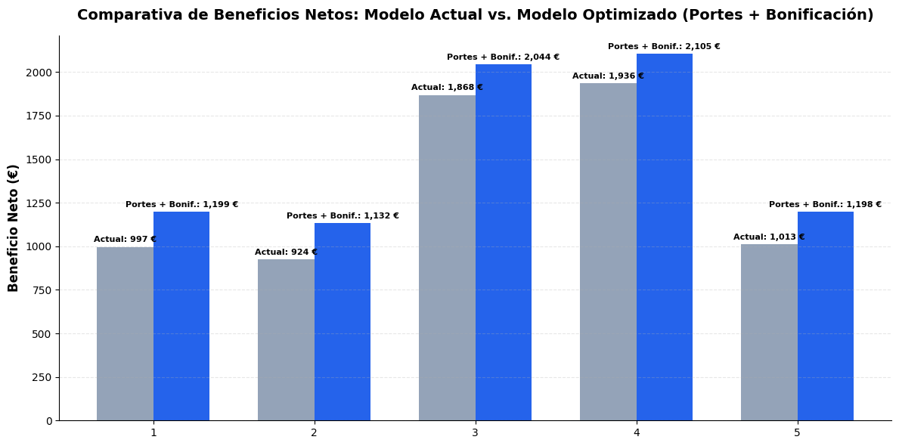

# Proyecto 1 | Simulación PYME Residuos: Optimización de Márgenes

Olvídate de los datasets perfectos y los casos de estudio de manual. Este proyecto trata de coger el caos de tarifas de una pequeña empresa de residuos, poner orden con datos y demostrarle al jefe con una sola tabla por qué nos estábamos jugando el cuello con un solo cliente.

---

## 🎯 El Problema de Trinchera
Tenemos una pyme del sector de la gestión de residuos que sufre dos grandes males:
1. **Un modelo de precios 100% intuitivo**, basado en lo que "parece" razonable pero sin números reales detrás.
2. **Una dependencia crítica de la Empresa 3**, nuestro cliente más rentable —que sostiene gran parte del beneficio gracias al plástico—, pero con el peligro latente de que un cambio de tarifas a ciegas pueda espantarlo.

A un jefe de pyme no le hables de métricas abstractas: o le pones la cruda realidad en euros delante o la empresa seguirá navegando a ciegas.

---

## 💡 La Solución Propuesta
Para arreglar esto sin romper la relación con el cliente clave ni ahogar a la empresa, hemos diseñado un modelo estructurado en tres medidas:
* **Alquiler fijo por contenedor:** Una cuota base de 50 €/mes por contenedor para cubrir de entrada los costes fijos de inmovilizado.
* **Tasa de transporte racionalizada:** Calculada en función del coste real por kilómetro (descontando maniobras y aplicando un margen operativo prudente).
* **Abono por plástico limpio:** Una bonificación por kilogramo exclusivamente para los contenedores de plástico puro, neutralizando la subida del porte y reteniendo al cliente estrella.

---

## 📊 El Veredicto (La tabla que abre los ojos)

| **Situación Actual** | Alta dependencia y riesgo severo por márgenes mal calculados. |

| Mes     |    Beneficio con E3    |    Beneficio sin E3    |    % Dependencia    |
| :---    | :--------------------: | :--------------------: | :-----------------: |
| **01**  |       996.59 €         |       281.63 €         |        72.0%        |
| **02**  |       924.09 €         |       279.68 €         |        70.0%        |
| **03**  |      1,868.49 €        |       619.96 €         |        67.0%        |
| **04**  |      1,936.09 €        |       679.89 €         |        65.0%        |
| **05**  |      1,013.49 €        |       273.31 €         |        73.0%        |

| **Nuevo Escenario Sugerido** | Estabilidad garantizada, costes cubiertos y fidelización del cliente clave mediante incentivos reales. |

---

## 🛠️ Herramientas de Trabajo
* **Python** (Pandas, NumPy, Matplotlib)
* **Google Colab** (Entorno de desarrollo y documentación)
* **Lógica de Negocio Real** (Traducción de datos complejos a un idioma de 1 segundo para la gerencia)

---

## 🚀 ¿Quieres ver cómo se ha cocinado todo esto paso a paso?
Este README es solo la punta del iceberg. Si te interesa ver las tripas del código, los cruces de tablas granulares (`DI` -> `Viaje` -> `Mes/Nave`) y los mapas de ruta analíticos, puedes explorar el cuaderno completo aquí mismo:

**Aviso:** el cuaderno es largo y detallado. Pido disculpas por lo extenso, pero en este proyecto la letra pequeña era obligatoria para que el código tuviera sentido de principio a fin.

👉 **[Enlace al Cuaderno en Google Colab](https://colab.research.google.com/github/Alexandra-Ortega/analisis-tarifas-pyme/blob/main/simulacionPYME.ipynb)**
